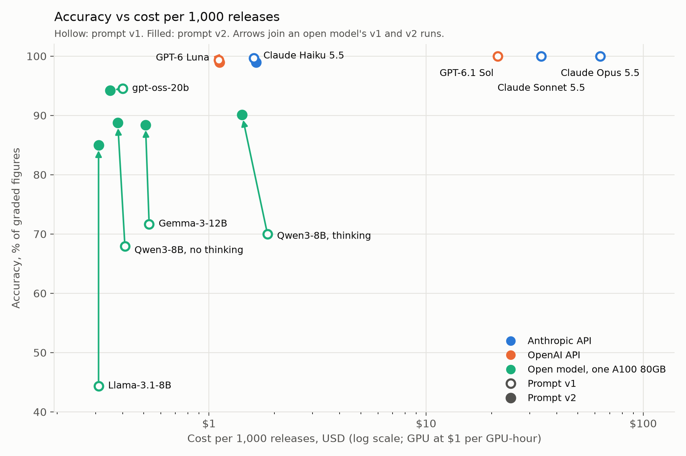

# sec-earnings-bench

Extract revenue, net income and diluted EPS from SEC earnings press releases with LLMs,
auto-graded against XBRL from the matching 10-Q/10-K.

**Results on 60 earnings releases, 293 graded figures per model:**

- **Three API models made no errors; the two cheapest came close.** Claude Opus 5.5,
  Claude Sonnet 5.5 and GPT-6.1 Sol got all 293 figures right. Claude Haiku 5.5 (292)
  and GPT-6 Luna (291) cost $1.61 and $1.11 per 1,000 releases, against $21.40 to
  $63.38 for the three perfect models.
- **Open models mostly failed on units, and a format change fixed most of it.** On one
  A100, 80% of their errors were unit slips: the right figure, off by a power of ten.
  Prompt v2 asks for each figure as printed plus its unit and converts in code. Their
  errors fell 65%; Llama-3.1-8B went from 44.4% to 85.0%.
- **Best open model: gpt-oss-20b, 94.2% at $0.35 per 1,000 releases** (one A100 80GB
  at $1 per GPU-hour). That is about a third of GPT-6 Luna's cost, with 17 misses to
  Luna's 3 on the same prompt.

## Results

| Model | Runs on | Prompt | Accuracy | Unit slips | Cost / 1,000 releases | Typical time per call |
| --- | --- | --- | --- | --- | --- | --- |
| Claude Opus 5.5 | Anthropic API | v1 | 293/293 (100.0%) | 0 | $63.38 | 3.29 s |
| Claude Sonnet 5.5 | Anthropic API | v1 | 293/293 (100.0%) | 0 | $33.95 | 1.39 s |
| GPT-6.1 Sol | OpenAI API | v1 | 293/293 (100.0%) | 0 | $21.40 | 1.81 s |
| Claude Haiku 5.5 | Anthropic API | v1 | 292/293 (99.7%) | 0 | $1.61 | 1.23 s |
| Claude Haiku 5.5 | Anthropic API | v2 | 290/293 (99.0%) | 2 | $1.65 | 1.36 s |
| GPT-6 Luna | OpenAI API | v1 | 291/293 (99.3%) | 0 | $1.11 | 2.60 s |
| GPT-6 Luna | OpenAI API | v2 | 290/293 (99.0%) | 0 | $1.12 | 2.38 s |
| gpt-oss-20b | 1× A100 80GB | v1 | 277/293 (94.5%) | 5 | $0.40 | 18.91 s |
| gpt-oss-20b | 1× A100 80GB | v2 | 276/293 (94.2%) | 0 | $0.35 | 19.25 s |
| Qwen3-8B (thinking) | 1× A100 80GB | v1 | 205/293 (70.0%) | 73 | $1.86 | 78.62 s |
| Qwen3-8B (thinking) | 1× A100 80GB | v2 | 264/293 (90.1%) | 3 | $1.42 | 63.21 s |
| Qwen3-8B (no thinking) | 1× A100 80GB | v1 | 199/293 (67.9%) | 81 | $0.41 | 22.24 s |
| Qwen3-8B (no thinking) | 1× A100 80GB | v2 | 260/293 (88.7%) | 14 | $0.38 | 21.39 s |
| Gemma-3-12B | 1× A100 80GB | v1 | 210/293 (71.7%) | 59 | $0.53 | 27.66 s |
| Gemma-3-12B | 1× A100 80GB | v2 | 259/293 (88.4%) | 13 | $0.51 | 26.81 s |
| Llama-3.1-8B | 1× A100 80GB | v1 | 130/293 (44.4%) | 137 | $0.31 | 16.20 s |
| Llama-3.1-8B | 1× A100 80GB | v2 | 249/293 (85.0%) | 4 | $0.31 | 18.08 s |

- **Accuracy:** correct figures out of the 293 with an answer in XBRL (revenue, net
  income and diluted EPS, for the quarter and the fiscal year to date).
- **Unit slips:** wrong figures that match the answer once multiplied or divided by a
  power of ten.
- **Cost:** API runs at list token prices. GPU runs at **$1.00 per GPU-hour** times the
  run's wall-clock time, so they compare with each other; the runs actually paid
  $0.167 per GPU-hour (v1) and $0.056 (v2). Open models are served by vLLM.
- **Time per call:** median latency, with 4 calls at a time on the APIs and 16 sharing
  the GPU.
- **Settings:** API models at medium effort. Gemma, Llama and Qwen3 without thinking
  ran at temperature 0; Qwen3 with thinking and gpt-oss-20b at their default sampling.
- Every verdict for every run is in [results/comparison.md](results/comparison.md).



## Findings

- **Cheap API models nearly match the best.** On prompt v1, Claude Haiku 5.5 missed 1
  figure and GPT-6 Luna 2, at $1.61 and $1.11 per 1,000 releases. The perfect models
  cost $21.40 (GPT-6.1 Sol) to $63.38 (Claude Opus 5.5).
- **Same price per token, different cost per release.** Claude Haiku 5.5 and GPT-6 Luna
  have the same token prices ($0.1 in, $0.5 out per million), yet Haiku costs 45% more
  per release. The gap is input tokens. Claude's tokenizer counts an average release as
  15,296 input tokens against GPT's 10,323, 48% more. Claude Sonnet 5.5 and GPT-6.1 Sol
  (both $2 and $10) differ by 59% per release, and so do their input tokens (16,386
  against 10,323, Sonnet's including 4 retried replies). Compare models on cost per
  document, not price per token.
- **80% of open-model errors were unit slips.** On prompt v1, 355 of the 444 errors
  across the five open-model set-ups were figures off by a power of ten, usually a
  table's "in millions" applied wrongly. The models found the right line and got the
  conversion wrong. Llama-3.1-8B alone had 137.
- **Prompt v2 cut open-model errors 65% and unit slips 90%.** Only the output format
  changed: revenue and net income come back as printed with their unit
  (`{"value": ..., "unit": "millions"}`) and code does the arithmetic. Errors fell from
  444 to 157 and unit slips from 355 to 34. It did not help the API models, which made
  no unit slips on v1: Haiku went from 292 to 290 correct (2 unit slips on v2) and
  GPT-6 Luna from 291 to 290.
- **Thinking on Qwen3-8B: +4 figures for 3.7x the GPU time.** On prompt v2, Qwen3-8B
  got 264 figures right with thinking and 260 without, at $1.42 against $0.38 per
  1,000 releases.
- **The Oracle net income trap.** Oracle's recent income statements show two bottom
  lines, "Net income" and "Net income available to common shareholders" (after
  preferred dividends). XBRL's `NetIncomeLoss` is the first. The prompt asks for net
  income attributable to the company and says nothing about preferred dividends.
  Every v1 miss by the cheap API models is this line (Haiku 1, GPT-6 Luna 2); the
  larger models got it right. On v2, Haiku's and Luna's misses are the same line again,
  apart from Haiku's 2 Netflix unit slips. A prompt fix is queued as its own version.

## Method

**Data.** 8-K filings that report Item 2.02 (results of operations) from 10 large US
non-financial companies: AAPL, CAT, HD, MSFT, NFLX, NKE, NVDA, ORCL, WMT and XOM,
downloaded from SEC EDGAR and cached. The press release (EX-99.1) is converted from
HTML to Markdown with its tables intact. If it has no income statement, the exhibit
that does is appended; filings with no income statement at all (such as an executive
change) are left out. Each release is linked to the first 10-Q or 10-K filed on or after
it whose fiscal period ended at most 100 days before it, giving 60 linked releases.

**Answer key.** XBRL company facts, using only facts reported in the linked filing
(matched by accession number) for its period. The first tag with a value wins:

- revenue: `Revenues`, then `RevenueFromContractWithCustomerExcludingAssessedTax`;
- net income: `NetIncomeLoss`, then `NetIncomeLossAvailableToCommonStockholdersBasic`,
  then `ProfitLoss` only when noncontrolling interest is tagged zero;
- diluted EPS: `EarningsPerShareDiluted`, then `EarningsPerShareBasicAndDiluted`.

A 10-Q gives the quarter and the fiscal year to date, and a 10-K the full year.
Fourth-quarter revenue and net income are derived as the 10-K's full year minus the
third-quarter 10-Q's nine months. A check confirms every answer appears in the text
the model sees.

**Grader.** A figure is correct if it equals the answer after rounding to the precision
printed; EPS must be exact to the cent. A wrong figure gets the first verdict that
explains it:
- missing or sign;
- scale (off by 1,000 or 1,000,000) or zeros (another power of ten);
- wrong_period (another period's figure) or noncontrolling_interest (net income
  including minority interests);
- rounded, adjusted (a non-GAAP figure from the release), wrong_line (another table
  line), or other.

Each check is retried on the figure times a power of ten, and any match that needed
one counts as a unit slip.

**Prompts.** One change per version, so an effect can be credited to it. v1 asks for
raw dollars; v2 changes only the output format. Each released prompt is frozen, and
its SHA-256 is pinned in the tests. A reply that fails validation gets one retry with
its errors; if it is still invalid, its figures count as missing.

**Models.** API: the three Claude 5.5 tiers (Opus, Sonnet, Haiku) and the two OpenAI
models priced the same per token as Sonnet and Haiku (GPT-6.1 Sol, GPT-6 Luna), so each
pair is a same-price comparison. OpenAI's top model, GPT-6 Astra, was left out: Opus and
Sonnet had already scored 100%, so it could at best tie. Open-weight models were picked
by fixed rules: runs on one A100 80GB under vLLM (8-20B parameters), one model per major
open family (OpenAI, Google, Meta, Alibaba), a context window of at least 32k tokens, a
license that allows commercial use and fine-tuning, and a mix of reasoning and
non-reasoning models. That gives gpt-oss-20b, Gemma-3-12B, Llama-3.1-8B and Qwen3-8B;
Qwen3-8B runs with thinking on and off as a controlled comparison.

**Tests.** The tests run on saved SEC responses and never touch the network. Each step
has rows checked by hand against the filings, which the test suite asserts:
`tests/fixtures/links_handchecked.csv` (linking),
`tests/fixtures/answers_handchecked.csv` (answer key) and
`tests/fixtures/grade_handchecked.csv` (grader verdicts).

## Reproduce

Requires Python 3.11 and [uv](https://docs.astral.sh/uv/).

```sh
uv sync
cp .env.example .env    # set SEC_USER_AGENT="Your Name you@example.com"

# 1. Data: releases, links to 10-Q/10-K, XBRL answer key
uv run python -m secbench.releases AAPL CAT HD MSFT NFLX NKE NVDA ORCL WMT XOM \
    --since 2025-04-01 --until 2026-10-10
uv run python -m secbench.link
uv run python -m secbench.answers
uv run python -m secbench.grade --check-inputs   # every answer is in the model input

# 2. One run per model and prompt; each run is graded when it finishes
uv run python -m secbench.extract --env-file .env.gpt-6-luna --prompt extract_v2

# 3. Comparison table and chart
uv run python -m secbench.compare --gpu-hourly 1
uv run python scripts/plot_results.py

uv run pytest
```

Each model gets a settings file. For an API model:

```sh
# .env.gpt-6-luna
MODEL_PROVIDER=openai
MODEL_BASE_URL=https://api.openai.com/v1
MODEL_NAME=gpt-6-luna
MODEL_API_KEY=...
MODEL_EFFORT=medium
MODEL_PRICE_INPUT=0.1
MODEL_PRICE_OUTPUT=0.5
```

For an open model, serve it with vLLM's OpenAI-compatible server on the A100, one
model at a time:

```sh
vllm serve openai/gpt-oss-20b --max-model-len 65536
vllm serve google/gemma-3-12b-it --max-model-len 65536
vllm serve meta-llama/Llama-3.1-8B-Instruct --max-model-len 65536
vllm serve Qwen/Qwen3-8B --max-model-len 40960
```

and point its settings file at it:

```sh
# .env.llama-8b
MODEL_BASE_URL=http://localhost:8000/v1
MODEL_NAME=meta-llama/Llama-3.1-8B-Instruct
MODEL_TEMPERATURE=0
MODEL_CONCURRENCY=16
MODEL_GPU_HOURLY=1
```

Qwen3-8B without thinking adds two settings (single-quote the JSON in a settings file):

```sh
# .env.qwen3-8b-nothink
MODEL_BASE_URL=http://localhost:8000/v1
MODEL_NAME=Qwen/Qwen3-8B
MODEL_TEMPERATURE=0
MODEL_EXTRA_BODY='{"chat_template_kwargs": {"enable_thinking": false}}'
MODEL_CONCURRENCY=16
MODEL_GPU_HOURLY=1
```

Claude models use `MODEL_PROVIDER=anthropic`. Every run saves its raw requests and
replies under `runs/`. SEC data can be amended, so a fresh download may differ
slightly.

## Limitations

- **Small sample:** 293 graded figures from 10 companies.
- **No held-out set yet:** prompt v2 was designed on this same set.
- **Sampling:** runs without temperature 0 vary from run to run, and repeat runs are
  pending.
- **GPU cost:** counts only the run's wall-clock time, not model loading, setup or idle
  time.
- **Fourth-quarter EPS isn't graded:** XBRL has no fourth-quarter value, and EPS can't
  be derived by subtraction.

## Next

Fine-tuning Qwen3-8B with LoRA, tested on companies it never saw in training.
