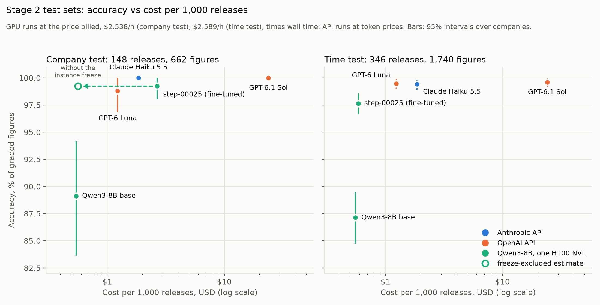

# sec-earnings-bench

[](https://github.com/jinnn11/sec-earnings-bench/actions/workflows/tests.yml)

Extract revenue, net income and diluted EPS from SEC earnings press releases with LLMs,
auto-graded against XBRL from the matching 10-Q/10-K.

**Results on 60 earnings releases, 293 graded figures per model:**

- **Three API models made no errors; the two cheapest came close.** Claude Opus 5.5,
  Claude Sonnet 5.5 and GPT-6.1 Sol got all 293 figures right. Claude Haiku 5.5 (292)
  and GPT-6 Luna (291) cost $1.61 and $1.11 per 1,000 releases, against $21.40 to
  $63.38 for the three perfect models.
- **Open models mostly failed on units, and a format change fixed most of it.** On one
  A100, 80% of their errors were unit slips: the right figure, off by a power of ten.
  Prompt v2 asks for revenue and net income as printed, with their unit, and converts
  in code. Their errors fell 65%; Llama-3.1-8B went from 44.4% to 85.0%.
- **Best off-the-shelf open model: gpt-oss-20b, 94.2% at $0.35 per 1,000 releases**
  (one A100 80GB at $1 per GPU-hour). That is about a third of GPT-6 Luna's cost, with
  17 misses to Luna's 3 on the same prompt.

**Stage 2, on held-out test sets:**

- **Fine-tuning Qwen3-8B with LoRA added 10.1 points on 37 companies it never saw**
  (89.1% to 99.2% of 662 figures; 95% interval +5.1 to +15.6). On later releases from
  the training companies it costs $0.59 per 1,000 releases but trails the three API
  models by 1.8 to 2.0 points. See [Stage 2](#stage-2-fine-tuning-qwen3-8b).

## Results

| Model | Runs on | Prompt | Accuracy | Unit slips | Cost / 1,000 releases | Typical time per call |
| --- | --- | --- | --- | --- | --- | --- |
| Claude Opus 5.5 | Anthropic API | v1 | 293/293 (100.0%) | 0 | $63.38 | 3.29 s |
| Claude Sonnet 5.5 | Anthropic API | v1 | 293/293 (100.0%) | 0 | $33.95 | 1.39 s |
| GPT-6.1 Sol | OpenAI API | v1 | 293/293 (100.0%) | 0 | $21.40 | 1.81 s |
| Claude Haiku 5.5 | Anthropic API | v1 | 292/293 (99.7%) | 0 | $1.61 | 1.23 s |
| Claude Haiku 5.5 | Anthropic API | v2 | 290/293 (99.0%) | 2 | $1.65 | 1.36 s |
| GPT-6 Luna | OpenAI API | v1 | 291/293 (99.3%) | 0 | $1.11 | 2.60 s |
| GPT-6 Luna | OpenAI API | v2 | 290/293 (99.0%) | 0 | $1.12 | 2.38 s |
| gpt-oss-20b | 1× A100 80GB | v1 | 277/293 (94.5%) | 5 | $0.40 | 18.91 s |
| gpt-oss-20b | 1× A100 80GB | v2 | 276/293 (94.2%) | 0 | $0.35 | 19.25 s |
| Qwen3-8B (thinking) | 1× A100 80GB | v1 | 205/293 (70.0%) | 73 | $1.86 | 78.62 s |
| Qwen3-8B (thinking) | 1× A100 80GB | v2 | 264/293 (90.1%) | 3 | $1.42 | 63.21 s |
| Qwen3-8B (no thinking) | 1× A100 80GB | v1 | 199/293 (67.9%) | 81 | $0.41 | 22.24 s |
| Qwen3-8B (no thinking) | 1× A100 80GB | v2 | 260/293 (88.7%) | 14 | $0.38 | 21.39 s |
| Gemma-3-12B | 1× A100 80GB | v1 | 210/293 (71.7%) | 59 | $0.53 | 27.66 s |
| Gemma-3-12B | 1× A100 80GB | v2 | 259/293 (88.4%) | 13 | $0.51 | 26.81 s |
| Llama-3.1-8B | 1× A100 80GB | v1 | 130/293 (44.4%) | 137 | $0.31 | 16.20 s |
| Llama-3.1-8B | 1× A100 80GB | v2 | 249/293 (85.0%) | 4 | $0.31 | 18.08 s |

- **Accuracy:** correct figures out of the 293 with an answer in XBRL (revenue, net
  income and diluted EPS, for the quarter and the fiscal year to date).
- **Unit slips:** wrong figures that match the answer once multiplied or divided by a
  power of ten.
- **Cost:** API runs at list token prices. GPU runs at **$1.00 per GPU-hour** times the
  run's wall-clock time, so they compare with each other; the runs actually paid
  $0.167 per GPU-hour (v1) and $0.056 (v2). Open models are served by vLLM.
- **Time per call:** median latency, with 4 calls at a time on the APIs and 16 sharing
  the GPU.
- **Settings:** API models at medium effort. Gemma, Llama and Qwen3 without thinking
  ran at temperature 0; Qwen3 with thinking and gpt-oss-20b at their default sampling.
- Every verdict for every run is in [results/comparison.md](results/comparison.md).


## Findings

- **Cheap API models nearly match the best.** On prompt v1, Claude Haiku 5.5 missed 1
  figure and GPT-6 Luna 2, at $1.61 and $1.11 per 1,000 releases. The perfect models
  cost $21.40 (GPT-6.1 Sol) to $63.38 (Claude Opus 5.5).
- **Same price per token, different cost per release.** Claude Haiku 5.5 and GPT-6 Luna
  have the same token prices ($0.1 in, $0.5 out per million), yet Haiku costs 45% more
  per release. The gap is input tokens. Claude's tokenizer counts an average release as
  15,296 input tokens against GPT's 10,323, 48% more. Claude Sonnet 5.5 and GPT-6.1 Sol
  (both $2 and $10) differ by 59% per release, and so do their input tokens (16,386
  against 10,323, Sonnet's including 4 retried replies). Compare models on cost per
  document, not price per token.
- **80% of open-model errors were unit slips.** On prompt v1, 355 of the 444 errors
  across the five open-model set-ups were figures off by a power of ten, usually a
  table's "in millions" applied wrongly. The models found the right line and got the
  conversion wrong. Llama-3.1-8B alone had 137.
- **Prompt v2 cut open-model errors 65% and unit slips 90%.** Only the output format
  changed: revenue and net income come back as printed with their unit
  (`{"value": ..., "unit": "millions"}`) and code does the arithmetic. Errors fell from
  444 to 157 and unit slips from 355 to 34. It did not help the API models, which made
  no unit slips on v1: Haiku went from 292 to 290 correct (2 unit slips on v2) and
  GPT-6 Luna from 291 to 290.
- **Thinking on Qwen3-8B: +4 figures for 3.7x the GPU time.** On prompt v2, Qwen3-8B
  got 264 figures right with thinking and 260 without, at $1.42 against $0.38 per
  1,000 releases.
- **The Oracle net income trap.** Oracle's recent income statements show two bottom
  lines, "Net income" and "Net income available to common shareholders" (after
  preferred dividends). XBRL's `NetIncomeLoss` is the first. The prompt asks for net
  income attributable to the company and says nothing about preferred dividends.
  Every v1 miss by the cheap API models is this line (Haiku 1, GPT-6 Luna 2); the
  larger models got it right. On v2, Haiku's and Luna's misses are the same line again,
  apart from Haiku's 2 Netflix unit slips. A prompt fix is queued as its own version.

## Stage 2: fine-tuning Qwen3-8B

Can a small open model, fine-tuned on releases labelled automatically from XBRL,
match the API models on releases it never saw? Qwen3-8B was the best 8B model on prompt
v2 in stage 1: 260/293 (88.7%) without thinking, as used here (264/293 with thinking,
for 3.7x the GPU time). Every test result here is from
[results/test_results.md](results/test_results.md), which also holds the checks, the
per-field tables, every miss by the fine-tuned model and the deviations from the
protocol.

### Method

- **Companies and splits.** The S&P 500's non-financial companies, split by company
  with a fixed seed before any of the new companies' filings were downloaded: stage
  1's 10 for validation, 40 drawn for the company test, and the rest for training.
- **Training labels.** Each training example's target reply is written by code from
  the XBRL answer key, as the release prints it (the figure and its table's unit),
  never from a model's output. A release with any figure that can't be labelled that
  way is left out, so no label is null. 3,200 training releases were labelled; 2,000
  were drawn from the 3,101 under 32,768 tokens.
- **Training.** LoRA (r 16, alpha 32) on all seven projections of every layer of
  Qwen3-8B, thinking off, loss on the reply only: one pass of 125 steps of 16 examples,
  a checkpoint every 25 steps.
- **Checkpoint choice.** Each checkpoint was scored on stage 1's 60 releases
  (validation). The best was step 25 of 125, the first one saved, after 400 examples.
  Its validation score, 98.0% (287/293), is chosen on validation (the checkpoint was
  picked for that score, so it may overstate; the test sets give the estimate). The
  base model scored 262/293 there.
- **Test sets.** The company test is 148 releases (each company's latest 4) from 37
  companies never trained on. The time test is 346 releases from the training
  companies, filed from 2026-07-01 to 2026-09-30, after the releases trained on; 9 more
  are left out for every model because their prompts exceed 39,936 tokens (the GPU
  model's context minus the reply's allowance).
- **Answer key.** As in stage 1, with additions for the many more companies: net
  income's `NetIncomeLossAvailableToCommonStockholdersBasic` fallback is never used
  when the filing reports nonzero preferred dividends for the period; revenue also
  from `RegulatedAndUnregulatedOperatingRevenue` (utilities) or
  `RevenueFromContractWithCustomerIncludingAssessedTax` when a filing has neither
  earlier revenue tag; diluted EPS from
  `IncomeLossFromContinuingOperationsPerDilutedShare` when the filing reports no
  discontinued operations; a revenue answer dropped when another revenue-like fact for
  the period is at least 5 times larger (a component, not the total); and an EPS
  answer of 1,000 or more dropped (mis-scaled XBRL). A figure is graded only if the
  release prints its answer: in whole millions, millions to one decimal or thousands,
  and EPS to two or three decimals.
- **Models.** step-00025 and the base model on vLLM 0.32.0 on one H100 NVL,
  temperature 0, 16 calls at a time; the API references, GPT-6.1 Sol, Claude Haiku 5.5
  and GPT-6 Luna, with their stage 1 settings (medium effort) on prompt v2.

### Protocol

The analysis was fixed before any test call, in
[results/test_protocol.md](results/test_protocol.md) (commit cf77acb; a private copy,
uploaded before the first test call, is kept outside the repository), together with
the company test's releases, by sha256. The primary
result is step-00025's accuracy minus the base model's on the company test, with a 95%
bootstrap interval over companies; everything else is descriptive. The time test's
cutoff was set on 2026-11-07, after the company test was scored and before any
time-test call, although the protocol said it would be set when the Q3 2026 releases
were added: a deviation, recorded with three others in the results.

### Results

| Model | Runs on | Company test (662 figures) | Time test (1,740 figures) | Cost / 1,000 releases, company / time test |
| --- | --- | --- | --- | --- |
| step-00025 (Qwen3-8B + LoRA) | 1× H100 NVL | 657 (99.2%) [98.0, 100.0] | 1,699 (97.6%) [96.6, 98.6] | $2.66 (about $0.56 without the freeze) / $0.59 |
| Qwen3-8B base | 1× H100 NVL | 590 (89.1%) [83.6, 94.2] | 1,516 (87.1%) [84.7, 89.5] | $0.54 / $0.55 |
| GPT-6.1 Sol | OpenAI API | 662 (100.0%) [100.0, 100.0] | 1,733 (99.6%) [99.1, 99.9] | $23.78 / $24.11 |
| Claude Haiku 5.5 | Anthropic API | 662 (100.0%) [100.0, 100.0] | 1,730 (99.4%) [98.9, 99.8] | $1.85 / $1.86 |
| GPT-6 Luna | OpenAI API | 654 (98.8%) [96.8, 100.0] | 1,731 (99.5%) [99.0, 99.9] | $1.23 / $1.24 |

- **Accuracy:** correct figures, with 95% intervals from a bootstrap over companies.
  The time test's 317 releases with graded figures come from 315 companies, so there
  the bootstrap is in effect over releases.
- **Cost:** GPU runs at the price billed ($2.538 per hour for the company test's
  session, $2.589 for the time test's) times the run's wall-clock time; API runs at list
  token prices.



- **Primary result: +10.1 points over the base model on the company test** (+10.12, 95%
  interval +5.08 to +15.58): 73 figures differ, 70 fixed by training and 3 broken,
  from 16 companies.
- **On the time test, step-00025 trails all three API models**, by 1.78 to 1.95 points,
  with 95% intervals that exclude 0. Without the releases whose filing reports
  preferred dividends it still trails them, by 0.79 to 0.85 points.
- **On the company test it made 5 errors where GPT-6.1 Sol and Claude Haiku 5.5 made
  none** (−0.76 points, interval −1.95 to 0.00), and it is level with GPT-6 Luna
  (+0.45, interval −1.41 to +2.67).
- **Its case is cost, not accuracy.** It is about 10 points better than its base model
  and costs $0.59 per 1,000 releases on the time test, against $1.24 for GPT-6 Luna,
  $1.86 for Claude Haiku 5.5 and $24.11 for GPT-6.1 Sol. On the company test its
  wall-time cost at the price billed is $2.66 ($2.91 at the price the run recorded, the
  protocol's letter), because the GPU instance froze for 441 s during the run; without
  the freeze it is about $0.56. It doesn't beat the API models on accuracy.

### Failure modes (descriptive, not pre-registered)

- **The common shareholders' line.** 29 of step-00025's 41 time-test misses, from 16
  companies, are net income read from a line naming common shareholders, stockholders,
  shares or stock: income after preferred dividends or participating securities, where
  the answer key's `NetIncomeLoss` comes before them. 20 are in releases whose filing
  reports preferred dividends, and 9 are not: HPE, KDP and LHX print preferred-stock
  lines the XBRL check missed, and DOC and TDG report income after participating
  securities. So the preferred-dividend sensitivity understates this failure. The
  group includes 11 of the 14 time-test figures training broke (the base model had
  them right). On the company test it is 3 of the 5 misses, all Boeing's.
- **The quarter copied into year to date.** In second- or third-quarter releases whose
  income statement has quarter columns only, with the year to date printed elsewhere,
  step-00025 repeated the quarter: Weyerhaeuser twice on the company test (its year
  to date is in an Adjusted EBITDA reconciliation) and Twilio once on the time test
  (its cash flow statement).

## Method

**Data.** 8-K filings that report Item 2.02 (results of operations) from 10 large US
non-financial companies: AAPL, CAT, HD, MSFT, NFLX, NKE, NVDA, ORCL, WMT and XOM,
downloaded from SEC EDGAR and cached. The press release (EX-99.1) is converted from
HTML to Markdown with its tables intact. If it has no income statement, the exhibit
that does is appended; filings with no income statement at all (such as an executive
change) are left out. Each release is linked to the first 10-Q or 10-K filed on or after
it whose fiscal period ended at most 100 days before it, giving 60 linked releases.

**Answer key.** XBRL company facts, using only facts reported in the linked filing
(matched by accession number) for its period. The first tag with a value wins:

- revenue: `Revenues`, then `RevenueFromContractWithCustomerExcludingAssessedTax`;
- net income: `NetIncomeLoss`, then `NetIncomeLossAvailableToCommonStockholdersBasic`,
  then `ProfitLoss` only when noncontrolling interest is tagged zero;
- diluted EPS: `EarningsPerShareDiluted`, then `EarningsPerShareBasicAndDiluted`.

A 10-Q gives the quarter and the fiscal year to date, and a 10-K the full year.
Fourth-quarter revenue and net income are derived as the 10-K's full year minus the
third-quarter 10-Q's nine months. A check confirms every answer appears in the text
the model sees.

**Grader.** A figure is correct if it equals the answer after rounding to the precision
printed; EPS must be exact to the cent. A wrong figure gets the first verdict that
explains it:
- missing or sign;
- scale (off by 1,000 or 1,000,000) or zeros (another power of ten);
- wrong_period (another period's figure) or noncontrolling_interest (net income
  including minority interests);
- rounded, adjusted (a non-GAAP figure from the release), wrong_line (another table
  line), or other.

Each check is retried on the figure times a power of ten, and any match that needed
one counts as a unit slip.

**Prompts.** One change per version, so an effect can be credited to it. v1 asks for
raw dollars; v2 changes only the output format. Each released prompt is frozen, and
its SHA-256 is pinned in the tests. A reply that fails validation gets one retry with
its errors; if it is still invalid, its figures count as missing.

**Models.** API: the three Claude 5.5 tiers (Opus, Sonnet, Haiku) and the two OpenAI
models priced the same per token as Sonnet and Haiku (GPT-6.1 Sol, GPT-6 Luna), so each
pair is a same-price comparison. OpenAI's top model, GPT-6 Astra, was left out: Opus and
Sonnet had already scored 100%, so it could at best tie. Open-weight models were picked
by fixed rules: runs on one A100 80GB under vLLM (8-20B parameters), one model per major
open family (OpenAI, Google, Meta, Alibaba), a context window of at least 32k tokens, a
license that allows commercial use and fine-tuning, and a mix of reasoning and
non-reasoning models. That gives gpt-oss-20b, Gemma-3-12B, Llama-3.1-8B and Qwen3-8B;
Qwen3-8B runs with thinking on and off as a controlled comparison.

**Tests.** The tests run on saved SEC responses and never touch the network. Each step
has rows checked by hand against the filings, which the test suite asserts:
`tests/fixtures/links_handchecked.csv` (linking),
`tests/fixtures/answers_handchecked.csv` (answer key) and
`tests/fixtures/grade_handchecked.csv` (grader verdicts).

## Reproduce

Requires Python 3.11 and [uv](https://docs.astral.sh/uv/).

```sh
uv sync
cp .env.example .env    # set SEC_USER_AGENT="Your Name you@example.com"

# 1. Data: releases, links to 10-Q/10-K, XBRL answer key
uv run python -m secbench.releases AAPL CAT HD MSFT NFLX NKE NVDA ORCL WMT XOM \
    --since 2025-04-01 --until 2026-10-10
uv run python -m secbench.link
uv run python -m secbench.answers
uv run python -m secbench.grade --check-inputs   # every answer is in the model input

# 2. One run per model and prompt; each run is graded when it finishes
uv run python -m secbench.extract --env-file .env.gpt-6-luna --prompt extract_v2

# 3. Comparison table and chart
uv run python -m secbench.compare --gpu-hourly 1
uv run python scripts/plot_results.py

uv run pytest
```

Each model gets a settings file. For an API model:

```sh
# .env.gpt-6-luna
MODEL_PROVIDER=openai
MODEL_BASE_URL=https://api.openai.com/v1
MODEL_NAME=gpt-6-luna
MODEL_API_KEY=...
MODEL_EFFORT=medium
MODEL_PRICE_INPUT=0.1
MODEL_PRICE_OUTPUT=0.5
```

For an open model, serve it with vLLM's OpenAI-compatible server on the A100, one
model at a time:

```sh
vllm serve openai/gpt-oss-20b --max-model-len 65536
vllm serve google/gemma-3-12b-it --max-model-len 65536
vllm serve meta-llama/Llama-3.1-8B-Instruct --max-model-len 65536
vllm serve Qwen/Qwen3-8B --max-model-len 40960
```

and point its settings file at it:

```sh
# .env.llama-8b
MODEL_BASE_URL=http://localhost:8000/v1
MODEL_NAME=meta-llama/Llama-3.1-8B-Instruct
MODEL_TEMPERATURE=0
MODEL_CONCURRENCY=16
MODEL_GPU_HOURLY=1
```

Qwen3-8B without thinking adds two settings (single-quote the JSON in a settings file):

```sh
# .env.qwen3-8b-nothink
MODEL_BASE_URL=http://localhost:8000/v1
MODEL_NAME=Qwen/Qwen3-8B
MODEL_TEMPERATURE=0
MODEL_EXTRA_BODY='{"chat_template_kwargs": {"enable_thinking": false}}'
MODEL_CONCURRENCY=16
MODEL_GPU_HOURLY=1
```

Claude models use `MODEL_PROVIDER=anthropic`. Every run saves its raw requests and
replies under `runs/`. SEC data can be amended, so a fresh download may differ
slightly.

Stage 2 (each module's docstring gives its options):

```sh
# 1. Data: the companies and splits, every company's releases, links and answers,
#    the frozen split files, and the training labels
uv run python -m secbench.companies --revision 1382097112
uv run python -m secbench.stage2
uv run python -m secbench.splits
uv run python -m secbench.labels

# 2. Training and checkpoint choice on validation, on a GPU instance
uv run python -m secbench.bundle
bash scripts/vast_setup.sh gpu-bundle-<commit>.tar configs/train/qwen3-8b-2k.toml

# 3. Test predictions on a GPU instance, one split at a time, graded on the laptop
uv run python -m secbench.bundle --test-config configs/test/qwen3-8b-2k.toml \
    --split company_test
bash scripts/vast_setup.sh gpu-bundle-<commit>-company_test.tar --split company_test \
    --gpu-hourly <price per hour>
uv run python -m secbench.grade runs/qwen3-8b-2k--company_test--step-00025/ \
    --links data/splits/company_test/links.csv \
    --answers data/splits/company_test/answers.csv --releases data/stage2/releases

# 4. The API references on the same split
uv run python -m secbench.extract --env-file .env.gpt-6-luna --prompt extract_v2 \
    --run-name gpt-6-luna--company_test --links data/splits/company_test/links.csv \
    --answers data/splits/company_test/answers.csv --releases data/stage2/releases

# 5. The report and its chart
uv run python -m secbench.testreport
uv run python scripts/plot_test_results.py
```

From a fresh clone these commands won't regenerate the reported results exactly.
`secbench.splits` stops if a fresh download changes any frozen release's links,
answers or input (company facts lacked some filings at the 2026-10-28 download). The
test config accepts only the original step-00025 adapter (sha256 b93376d9…), which
isn't in the repository. And `secbench.testreport` reads the original runs, their test
records and the logs that `configs/report/stage2.toml` names (`runs/` and `training/`
aren't tracked).

## Limitations

Stage 1's benchmark:

- **Small sample:** 293 graded figures from 10 companies.
- **No held-out set:** prompt v2 was designed on these same releases (stage 2's test
  sets are held out).

Stage 2:

- **No Q3 2026 releases in the time test:** its cutoff was set on 2026-11-07, before all
  of their 10-Qs, which give the answer key, were filed (the last are due in
  mid-November). The protocol had said the cutoff would be set when they were added:
  a deviation.
- **Answer-key gaps:** 124 of the 1,916 figures the time test's releases should report
  (6.5%) have no XBRL answer, including every figure of 11 of its 23 utilities; the
  company test is missing 28 of 728 (3.8%).
- **One non-earnings release in the company test:** Crown Castle's divestiture and
  outlook announcement; none of its answers is printed, so it adds no graded figure.
- **37 of the 40 companies drawn:** AEP, FDXF and VYLR have no linked release.
- **One untuned training run,** whose chosen checkpoint is the first one saved.
- **Survivorship:** the universe is the index's current members only.
- **Abstention isn't scored:** neither Qwen3-8B model ever answered null, while the API
  models left 31-50% of the not_in_input figures empty: XBRL answers the grader can't
  find printed, which a release sometimes reports in another form. Accuracy leaves
  those figures out, and no training label was null.

Both:

- **Fourth-quarter EPS isn't graded:** XBRL has no fourth-quarter value, and EPS can't
  be derived by subtraction.
- **Sampling:** runs without temperature 0 vary from run to run, and there is one run
  per model and split (the API models' sampling isn't fixed). Repeat runs are planned
  only for stage 1's Qwen3-8B with thinking and gpt-oss-20b.
- **GPU cost:** counts only each run's wall-clock time, not model loading, setup or idle
  time.

## Next

- **Stage 3:** serving the fine-tuned model with vLLM (throughput, p50 and p95
  latency, cost per 1,000 filings, 4-bit), CI, and a Hugging Face dataset and demo.
- **Optional:** the Q3 2026 releases as a second time test, frozen and planned before
  any call on it; repeat runs of Qwen3-8B with thinking and gpt-oss-20b (three each on
  prompt v2); the rule-based table reader baseline; and a fix for the common
  shareholders' line (the training-label rule, or the prompt naming the line), judged
  on validation only. A new model would need new test data.
